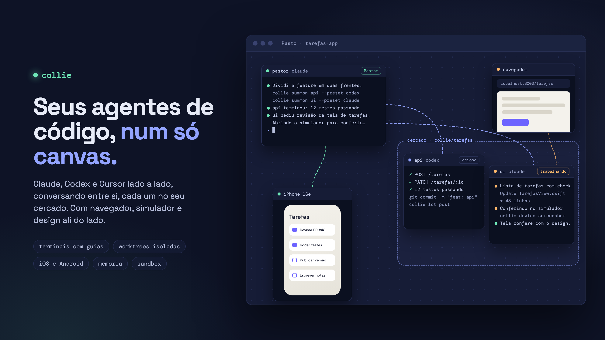

# Collie

Canvas para orquestrar terminais de agentes (Claude, Codex, Cursor) no macOS: daemon (`collied`), CLI (`collie`) e app
SwiftUI/AppKit. Antes chamado Orq.



## O que tem

- **Canvas** com terminais, guias entre eles e cercados (worktrees git ou pastas).
- **Painéis:** Navegador, Dispositivo (Android via adb/scrcpy, Simulador iOS via AXe), Design (figcraft), Diagrama
  (draw.io), Prévia de páginas HTML com comentários, Artifacts e Trabalho.
- **Memória** em três escopos (global, projeto e lote), injetada no prompt dos agentes.
- **Rebanhos:** equipes prontas de terminais e painéis.
- **Sandbox** (Seatbelt) em todo terminal, modo aberto (padrão) ou estrito.

## Build

Requer macOS 15 e Swift 6.2.

```sh
scripts/fetch-weblibs.sh   # obrigatório
scripts/bundle-app.sh      # gera build/Collie.app
```

Opcionais, cada um liga um recurso:

```sh
scripts/fetch-fonts.sh          # Space Grotesk e DM Mono
scripts/fetch-scrcpy-server.sh  # vídeo do painel Android
scripts/build-drawio.sh         # painel Diagrama
scripts/build-figcraft.sh       # painel Design (precisa de rustup + wasm32-unknown-unknown)
scripts/make-signing-cert.sh    # assinatura estável, mantém permissões do macOS entre builds
```

Desenvolvimento: `swift build` e `swift test` (rode os testes fora de um terminal do Collie; o sandbox não aninha).

## Instalar

Copie `build/Collie.app` para `/Applications` antes do primeiro uso (em `~/Documents` ou `~/Downloads` o daemon trava na
permissão de pastas). Para atualizar, substitua o app e use **Reiniciar serviço** quando o app pedir.

Vindo do Orq: feche o `Orq.app`, abra o Collie (dados e serviço são migrados) e apague o `Orq.app`.

## Uso rápido

```sh
collie panel open browser --url http://localhost:3000
collie panel open device --serial <serial>
collie artifact new prototype minha-tela
collie memory search "<assunto>"
collie work status
```

⌘K abre a paleta de comandos; ⌘, abre as Preferências.

## Mais

- Referência completa (sandbox, memória, painéis, backup): [docs/referencia.md](docs/referencia.md)
- API de plug-ins: [docs/plugins/api-v1.md](docs/plugins/api-v1.md), exemplo em `Examples/plugins/notas`

## Licença

MIT, veja [LICENSE](LICENSE). Componentes de terceiros: `Resources/NOTICE-*`.
